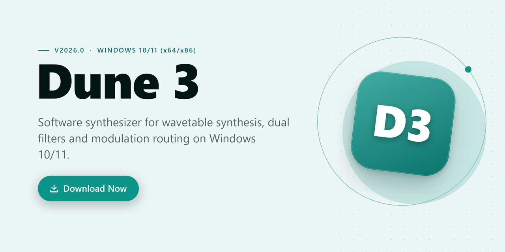

<h1 align="center">Synapse Dune 3: Wavetable Synthesizer and Sound Design Tool for Windows</h1>

<i>A Windows reference and setup guide for the Synapse Audio Dune 3 software synthesizer, wavetable and dual-filter capabilities, system profile, and the first-run sound design workflow.</i>

  
  
  

  <a href="https://byte-wolf-sync937.github.io/synapse-dune-3/">
    <picture>
      <source media="(prefers-color-scheme: dark)" srcset="./docs/media/button2.svg">
      
    </picture>
  </a>

## Introduction

Synapse Dune 3 is a software synthesizer built around wavetable synthesis, dual filters, and flexible modulation routing, and it runs on Windows 10 and 11. Beginners use it to learn how oscillators, filters, and envelopes shape a sound, while experienced professionals reach for it when they need rich pads, biting leads, and layered textures in a session. Because it plugs into a host DAW, it fits naturally into an existing production workflow rather than demanding a separate environment.

When you open Dune 3 you get a deep oscillator section, two independent filter blocks, and a modulation matrix that lets you route sources to almost any destination. You can start from a factory preset, tweak it, or build a patch from an init state and save it for later. The typical workflow runs from picking a preset or wavetable, shaping the filter and envelopes, assigning modulation, and then automating parameters from inside your DAW.

In the wider world of soft synths, Dune 3 sits among the versatile wavetable instruments that cover everything from EDM to cinematic scoring. Its sound engine supports a large preset library, and the modulation system rewards exploration, which keeps the instrument extensible for users who like to design from scratch. The community around it shares patches, tutorials, and sound design tips, and updates continue to refine the engine and interface.

## System Requirements

| Requirement | Details |
|-------------|---------|
| **Supported Windows Versions** | Windows 10, Windows 11 |
| **Architecture** | x64 |
| **Processor** | Intel Core i5 or AMD Ryzen 5 (quad-core or better recommended for dense patches) |
| **RAM** | 8 GB minimum, 16 GB recommended for multi-instance projects |
| **Storage** | Around 200 MB for the instrument plus space for presets and wavetables |
| **Permissions** | Administrative privileges may be required |
| **Internet Connection** | Required for activation and updates |
| **Dependencies** | VST3 or VST2 compatible host DAW, Visual C++ Redistributable, ASIO audio driver for low-latency playback |

To get the best performance from Dune 3, pair a modern multi-core CPU with a low-latency ASIO audio interface so that filter and modulation processing keeps up with real-time play. RAM matters most when you run several instances across a project, since each patch has its own voice pool and effects. On a machine near the minimum specs you can still play and design sounds, but dense unison patches and heavy modulation may cause dropouts, so reducing voice counts or freezing tracks helps.

## Features

- **Wavetable oscillators**: Load and morph through wavetables to create evolving tones, which is useful for pads, leads, and motion-heavy textures in your tracks.
- **Dual filter section**: Two independent filter blocks can run in series or parallel, letting you shape brightness and character with more control than a single filter.
- **Modulation matrix**: Route envelopes, LFOs, and other sources to nearly any destination, so you can build expressive patches that respond to your playing.
- **Unison and voice modes**: Stack voices and spread them for wide stereo sounds, and choose poly, mono, or legato behavior to match the part you are writing.
- **Built-in effects**: Add reverb, delay, chorus, and distortion inside the synth, which keeps your sound cohesive before it even reaches the DAW mixer.
- **Arpeggiator and sequencer**: Generate rhythmic patterns and arpeggios directly in the instrument, handy for fast idea sketching and layered rhythmic parts.
- **Preset browser**: Browse a large factory library by category, audition sounds quickly, and save your own patches for reuse across projects.
- **MIDI and automation support**: Map MIDI controllers to parameters and automate them from your DAW, so your performance and mix moves feel alive.

Community resources around Dune 3 include sound design walkthroughs, preset packs from third-party creators, and active forums where users swap tips on modulation and wavetable tricks. Beginners can follow along with tutorial videos, and professionals often share patch-building breakdowns that show how a single sound is assembled.

## How It Works

1. **Installation**: Download the installation package from the official source for Synapse Dune 3. Run the installer and follow the on-screen instructions to complete setup. Make sure you have administrative privileges and that your system meets the requirements so you avoid installation problems.

2. **Host setup**: Open your DAW and scan for new plugins so the synth appears in your instrument list. Insert Dune 3 on a MIDI or instrument track and confirm that audio and MIDI input are routed correctly before you start designing.

3. **Sound selection**: Browse the preset library or load an init patch to begin from silence. Pick a wavetable and set the oscillator tuning and unison to establish the base tone you want to build on.

4. **Shaping and modulation**: Adjust the dual filters, envelopes, and LFOs to shape the sound, then assign modulation sources in the matrix to add movement. Play your keyboard or draw MIDI notes to hear how the patch responds in context.

5. **Saving and exporting**: Save your patch in the synth's preset browser and save the project in your DAW. When the track is ready, render or export the audio from the host so the finished sound leaves the session.

## Compatibility

**Operating Systems and Architecture**
Dune 3 runs on Windows 10 and Windows 11 in 64-bit form, which matches current DAWs and plugin hosts. A 64-bit host is required to load it, and older 32-bit environments are not the target platform.

**Hardware Requirements**
A modern quad-core CPU and 8 GB of RAM form a solid baseline for smooth operation. More cores and memory help when you run several instances or use heavy unison and modulation settings.

**Runtime Dependencies**
You need a VST3 or VST2 compatible host, the Visual C++ Redistributable, and a working audio driver such as ASIO for low-latency playback. Keeping these components current avoids many plugin-loading issues.

**Limitations and Notes**
Performance scales with patch complexity, so a project full of layered unison sounds will use more CPU than a simple bass patch. Rendering or freezing tracks in your DAW is a practical way to manage load in larger sessions.

## FAQ

### What is Synapse Dune 3 used for?
Synapse Dune 3 is used to design and play synthesized sounds such as pads, leads, basses, and textures. You load it in a DAW, choose or build a patch, and use it as the sound source for your music or sound design work.

### How do I install Synapse Dune 3 on Windows?
To install Synapse Dune 3, download the installation package from the official source. Run the installer and follow the prompts to complete the setup process. Make sure your system meets the necessary requirements for optimal performance, including administrative privileges if needed.

### Is Synapse Dune 3 compatible with Windows 11?
Yes, Synapse Dune 3 is compatible with Windows 11. Running it on Windows 11 gives you the same wavetable engine and modulation tools with current system updates and driver support.

### Does Dune 3 work as a plugin inside my DAW, and can I use my own wavetables?
Dune 3 operates as a plugin inside a VST3 or VST2 compatible host, so it appears on your instrument tracks alongside your other plugins. You can load wavetables from the factory set and bring in your own samples to build custom oscillator content.

### What should I do if I encounter issues while using Synapse Dune 3?
If you experience issues while using Synapse Dune 3, check the software's official support documentation or community forums for troubleshooting tips. Common problems include plugin scan failures and audio dropouts, which are often resolved by rescanning in the DAW or adjusting buffer size.

## Disclaimer

Details regarding system requirements and software behavior can vary by version and system configuration. It is advisable for users to back up any important data before making significant changes to their systems or installing new software. Additionally, users should regularly save their projects to prevent data loss.

## License

The specific license details for Synapse Dune 3 are not provided here. Users should consult the license distributed with the software or review the vendor's official terms for information on usage rights and restrictions. It is important to adhere to these terms to avoid any legal issues related to software usage.
